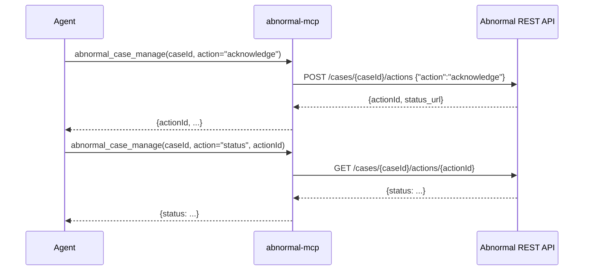

# PRD-21219 · [Security] Abnormal Security

Ticket: https://app.clickup.com/t/86e3v6w6z
Repo: https://github.com/MSPbotsAIFramework/abnormal-mcp@main (c636ead)
Work branch: dev/PRD-21219
Status: frozen @ 72f1923

## Requirement understanding

One line: Via the Abnormal Security integration, be able to review email threats, manage cases, and analyze attack patterns.

The ticket (full text): "Review email threats, manage cases, and analyze attack patterns via Abnormal Security. Link: https://conduit.wyre.ai/plugins/abnormal-security". The linked page (conduit.wyre.ai, a marketplace listing, fetched 2026-10-30) only repeats this same one-line description and does not add granular detail (no specific case action named). No other comments exist on the ticket besides the pipeline's own claim comment, so there is nothing else to reconcile this against.

## Current state (every claim carries path:line)

The vendor repo this connector needs already exists and is not a blank slate: `MSPbotsAIFramework/abnormal-mcp@main (c636ead, 2026-10-23)`. It is the only repo in MSPbotsAIFramework matching "abnormal" / "abnormal-security" / "abnormal-security-mcp" / "abnormalsecurity-mcp" (checked via the GitHub API, 2026-10-30).

Capability-by-capability, against the ticket's three verbs:

- **"Review email threats"** — covered. `abnormal_threats_list` / `abnormal_threats_get` (src/abnormal_mcp/tools/threats.py) and `abnormal_messages_list` / `abnormal_messages_get` (src/abnormal_mcp/tools/messages.py) let an agent list and read threats and the messages behind them. `abnormal_remediation_manage` (src/abnormal_mcp/tools/remediation.py:32-62) lets an agent check or trigger remediation.
- **"Analyze attack patterns"** — covered. `abnormal_threats_list` takes an `attackType` filter (README.md:120) and `abnormal_abuse_list` (src/abnormal_mcp/tools/abuse.py) covers employee-reported campaigns, which together is what "attack patterns" maps to in this API.
- **"Manage cases"** — **not covered**. `src/abnormal_mcp/tools/cases.py:36-73` has exactly two tools, `abnormal_cases_list` and `abnormal_cases_get`, and both are registered with `annotations=READ_ONLY` (`_common.py:35`, imported at `cases.py:23`). There is no tool that takes an action on a case (e.g. acknowledging it) the way `abnormal_remediation_manage` already does for threats. This is the one gap between what exists and what the ticket asks for.

wiki: searched `ProductDocs/` for "abnormal" (2026-10-30, fact base at `mbagent-wiki@bc0d95c`) — 0 hits. This connector has no docs.mspbots.ai page yet; `ProductDocs/15-Capabilities.md § Connectors section` documents the platform's generic "add a connector" UX but says nothing specific to Abnormal Security. Noted as "wiki not covered" per the rule that a gap must be stated, not silently skipped; the connector-wiki page itself is written in the review leg after the INT publish (`mcp-track.md` §4.5), not in this design.

## Product design

### Goals / Non-goals

- Goal: close the "manage cases" gap by adding one tool that lets an agent take an action on an Abnormal account-takeover case (e.g. acknowledge it) and check the status of a previously-submitted action, mirroring the shape `abnormal_remediation_manage` already uses for threats.
- Non-goal: changing any of the existing threat / message / abuse / case-read tools — they already satisfy "review email threats" and "analyze attack patterns" and are out of scope.
- Non-goal: OAuth, new credential headers, or gateway changes — this ticket does not touch authentication.

### Acceptance criteria AC1..ACn

- AC1: Given a valid Abnormal API token and an existing case ID, When the agent calls the new tool with a supported action (e.g. `"acknowledge"`), Then the tool returns the `actionId` (and whatever else Abnormal's case-actions endpoint returns) as its result.
- AC2: Given an `actionId` returned by a previous case action, When the agent calls the new tool with `action="status"` and that `actionId`, Then the tool returns the current status document for that action.
- AC3: Given a case ID that does not exist, When the agent calls the new tool with any action, Then the tool returns the standard structured `not_found` error envelope, not an exception.
- AC4: Given a request to the server with no `Authorization` header, When the agent calls the new tool, Then it gets the same 401 the server already returns for every other tool — no new gap is opened.
- AC5: Given the new tool is registered, When the agent calls `abnormal_navigate(domain="cases")`, Then the new tool's name appears in that domain's tool list, so the per-domain guide stays accurate.
- AC6: Given the existing read tools already satisfy "review email threats" and "analyze attack patterns" (see Current state), When this ticket ships, Then none of `threats.py`, `messages.py`, `remediation.py`, `abuse.py`, or `_common.py` change behavior (no regression).

### Open questions

- [已假设 / assumed, not blocking] Abnormal's own first-party API reference for the case-actions endpoint was not found publicly during this design (searched 2026-10-30); the shape used here (`POST /cases/{caseId}/actions` body `{"action": "<action>"}` → `{actionId, status_url}`, `GET /cases/{caseId}/actions/{actionId}` → status) comes from third-party integration docs that wrap the same Abnormal API (LogicHub/DevoSOAR, Cortex XSOAR). Assumption: this shape is correct; if a real tenant test shows otherwise, only the tool's internal request/response handling needs adjusting, not the tool's name or parameters (§5 Non-functional already notes `run_tool()` returns whatever JSON comes back verbatim, so an unexpected shape doesn't break the tool, it just means the docstring needs a follow-up correction).
- [不阻塞 / not blocking] No real Abnormal tenant/test account is available to verify the above against. Per `mcp-track.md` §2.5 / §3, missing a vendor test account does not block INT publish; the automated tests use a mocked HTTP transport (same technique the repo's own `tests/test_api_client.py` already uses), and the real-account verification is listed as a manual, non-blocking test case (see Test cases, TC7).
- [已假设] The set of legal `action` values for a case is not documented as a closed enum anywhere public (unlike threat remediation, which is `remediate` / `unremediate` / `status`). Assumption: the tool accepts a free-form `action` string instead of a `Literal[...]`, and lets Abnormal's own API reject an unsupported value (surfaced through the existing `invalid_argument` error mapping) rather than the tool guessing the full enum. See Tech design §3 for the alternative considered and rejected.

## Tech design

### Conclusion

Add one new tool, `abnormal_case_manage`, to the existing `cases` domain in `MSPbotsAIFramework/abnormal-mcp`, mirroring the exact shape of the existing `abnormal_remediation_manage` tool for threats. No new dependency, no database (this is a stateless MCP server), no gateway change, no new credential header.

### Where the current implementation lives

- `src/abnormal_mcp/tools/cases.py:36-73` — the `cases` domain; both existing tools (`abnormal_cases_list`, `abnormal_cases_get`) are read-only (`READ_ONLY` annotation, `_common.py:35`).
- `src/abnormal_mcp/tools/remediation.py:26-63` — the pattern to mirror: a write tool with a string `action` argument, a `status` branch that reads (optionally by `actionId`), and other branches that `POST` `{"action": action}` to a per-resource endpoint.
- `src/abnormal_mcp/tools/navigation.py:25-44` — `DOMAIN_TOOLS["cases"]`, the per-domain index `abnormal_navigate` returns.
- `src/abnormal_mcp/server.py:46-67` (`INSTRUCTIONS`) and `:84` (tool registration tuple `for module in (navigation, threats, messages, remediation, abuse, cases)`) — the top-level tool catalogue and the usage guide shown to the agent; the `cases` module is already registered, so no change there, only to its content.
- `src/abnormal_mcp/api_client.py:127-130` — `AbnormalClient.get` / `.post`, already generic enough for the new calls; no client change needed.
- `tests/test_tools.py:26-37` — `EXPECTED_TOOLS` / `WRITE_TOOLS`, the explicit "tool names are a public contract" snapshot that has to be extended for the new tool, plus `test_navigate_covers_every_tool` (line 88-92) which will fail until `navigation.py` is updated too.

### Option analysis

| Option | Approach | Pros | Cost | Verdict |
|---|---|---|---|---|
| A. New tool `abnormal_case_manage` | Mirror `abnormal_remediation_manage`'s shape (action string, status branch) | Consistent with the one existing write-tool pattern in this repo; minimal new surface | One new tool to document/test | Chosen |
| B. Overload `abnormal_cases_get` with an optional `action` parameter | Add a write path to the existing read tool | Fewer tool names | Breaks the read/write separation the tests already assert (`test_annotations` requires every tool not in `WRITE_TOOLS` to be `readOnlyHint=True`); conflates a read and a write operation in one tool, which is worse for an agent's own planning (it can no longer tell from the tool name alone whether a call is safe to retry) | Rejected |

No third option considered: Abnormal's case-actions endpoint is a single, narrow capability, and a dedicated tool is the shape already used everywhere else in this repo (one tool per REST capability).

### Change list

- `src/abnormal_mcp/tools/cases.py` [改] — add `abnormal_case_manage(caseId: int | str, action: str, actionId: str | None = None) -> str`:
  - `action == "status"` requires `actionId` (raise `ValueError` if missing, which `run_tool()` already turns into an `invalid_argument` envelope, same as the existing `"caseId must not be blank"` check at `cases.py:69`) → `GET /cases/{caseId}/actions/{actionId}`.
  - any other `action` value (e.g. `"acknowledge"`) → `POST /cases/{caseId}/actions` with body `{"action": action}`.
  - wrap with `run_tool()`, escape both IDs with `path_id()`, same as every other tool in this file.
- `src/abnormal_mcp/tools/navigation.py:40-43` [改] — add `"abnormal_case_manage": "Acknowledge, or check the status of an action on, an account-takeover case."` to `DOMAIN_TOOLS["cases"]`.
- `src/abnormal_mcp/server.py` [改] — extend the `INSTRUCTIONS` "Account takeover" line (around line 64-65) to mention `abnormal_case_manage`; no change to the tool-registration tuple (the `cases` module is already registered).
- `README.md` [改] — add a row for `abnormal_case_manage` to the Tools table (README.md:116-128); add a line under "Delivery notes" noting it mirrors `abnormal_remediation_manage`'s shape but is **not** `destructiveHint=true` (acknowledging a case does not change mailbox content, unlike threat remediation).
- `tests/test_tools.py` [改] — add `"abnormal_case_manage": {"caseId", "action"}` to `EXPECTED_TOOLS` (line 26-37). `test_annotations` (line 71-79) currently only distinguishes two buckets (`WRITE_TOOLS` → `readOnlyHint=False, destructiveHint=True`, else → `readOnlyHint=True`); `abnormal_case_manage` is a third case (`readOnlyHint=False, destructiveHint=False`), so that test needs a small per-tool expected-annotations mapping instead of the current binary split — this is a test-code change, not a product-behavior change, so it is within the dev leg's freedom (see `references/handoff.md` on technical design vs. product design ownership).
- New test coverage for the tool's actual behavior (success / not-found / missing-actionId) — see Test strategy below; exact test file/function names are listed in the `.ac.json` ledger as the dev leg's red/green targets.

### Reuse & cleanup

- Reuse: `run_tool()`, `path_id()`, `ClientFactory`, `AbnormalClient.get` / `.post` (`_common.py`, `api_client.py`) — no new HTTP, retry, or auth code; same client every other tool already uses.
- New dependencies: none.
- API / parameter shape: `abnormal_case_manage(caseId, action, actionId=None)` matches the existing `abnormal_remediation_manage(threatId, messageId, action, actionId=None)` shape, so an agent (or a developer reading the tool list) sees the same pattern for both write tools in this server.
- In-scope cleanup: none found — `cases.py` is 73 lines with no dead code, no stale comments, nothing unused.
- Suggested follow-ups (out of scope for this ticket): none. The only other read-only domain (`abuse.py`, employee-reported campaigns) has no documented "management action" endpoint in Abnormal's API, so there is no parallel gap to flag there.

### Data & API contract

- New MCP tool: `abnormal_case_manage`
  - Request (MCP tool-call arguments): `caseId` (`int | string`, required — same `anyOf` shape as `abnormal_cases_get.caseId`, README.md:127 / `cases.py:62`), `action` (`string`, required — e.g. `"acknowledge"`, or `"status"` to poll a previous action), `actionId` (`string`, optional — required when `action="status"`).
  - Upstream REST calls (region-aware base URL, same as every other tool, `config.py` `REGION_BASE_URLS`):
    - `POST {base_url}/cases/{caseId}/actions` body `{"action": "<action>"}` → expected response `{"actionId": "...", "status_url": "..."}` (shape per third-party Abnormal integration docs, not independently verified — see Open questions / Risks).
    - `GET {base_url}/cases/{caseId}/actions/{actionId}` → action status document.
  - Response: same envelope convention as every other tool — `run_tool()` returns either the upstream JSON (capped, string-dumped) or the standard error envelope `{"error": {"code", "message", "retryable"}}` (`_json.py`).
  - DB: none — this is a stateless server with no persistence layer; not applicable.
  - Backward compatibility: purely additive. No existing tool's name, parameters, or response shape changes; `tools/list` grows by one entry.

### Key flow / sequence

1. Agent calls `abnormal_cases_list` / `abnormal_cases_get` to find a case (existing, unchanged).
2. Agent calls `abnormal_case_manage(caseId, action="acknowledge")` → `GatewayCredentialsMiddleware` (server.py, unchanged) attaches the caller's token → tool `POST`s to `/cases/{caseId}/actions` → returns `actionId`.
3. Agent calls `abnormal_case_manage(caseId, action="status", actionId=...)` → tool `GET`s `/cases/{caseId}/actions/{actionId}` → returns the current status.

### Non-functional

- Idempotency / concurrency: each call is a fresh HTTP request on the caller's own credentials; the server holds no state between requests (same contextvars-based isolation as every other tool, `server.py:38-44`). Whether submitting the same action twice is safe is Abnormal's own concern, not this server's — the tool description should say so, the way `abnormal_remediation_manage`'s docstring already warns about acting on a whole campaign.
- Performance: one upstream call per tool call, same latency budget as every existing tool (`_TIMEOUT`, `_CALL_BUDGET_SECONDS`, `api_client.py:29-33`). No new concern.
- Security: the token still only ever arrives via the `Authorization` header and is never stored (unchanged, `server.py` `GatewayCredentialsMiddleware`). No new credential, no new header. `caseId` / `actionId` are percent-encoded with `path_id()` before going into the URL path, same as every other ID in this repo — prevents path injection.
- Multi-tenant isolation: unaffected. The server is already per-request / stateless; the new tool carries no cross-request state.
- Observability: `run_tool()` already logs `tool=<name> outcome=... ms=<n>` for every call (`_common.py:129-141`) — the new tool gets this for free.

### Rollout & rollback

- Feature flag: none needed — a stateless MCP tool addition is gated only by the gateway's per-role, per-tool allowlist (deny-by-default, README.md "Control" section), not by a code-level flag.
- Rollout: ship on the next merge to `main`; publish to INT via the review leg's standard MCP publish step (`mcppub publish`). No cross-repo dependency — `release order: any`.
- Rollback: revert the merge commit; the tool disappears from `tools/list` on the next deploy. No data to roll back (stateless).

### Test strategy

- Unit/contract tests (no network, same style as the existing `tests/test_tools.py`): extend the parametrized `EXPECTED_TOOLS` / required-params / annotations / every-param-documented / navigate-coverage tests rather than writing new ones for this part.
- Behavior tests with a mocked HTTP transport (same technique `tests/test_api_client.py` already uses for the existing client — no new test infrastructure): acknowledge path builds the right `POST` body and path; status path builds the right `GET` path and requires `actionId`; a 404 from the upstream API surfaces as the standard `not_found` envelope through this specific tool (the generic mapping is already covered by `test_error_envelope_mapping`, but a case-manage-specific test proves it is actually wired through, not just tested in isolation via `AbnormalError`).
- Manual, needs a real vendor account (non-blocking, see Open questions): call `abnormal_case_manage` against a live Abnormal tenant with the Account Takeover license to confirm the real response shape for `action="acknowledge"` matches §5's assumption.
- Regression: run the full existing suite (`uv run pytest`) — this change must not alter `threats.py`, `messages.py`, `remediation.py`, `abuse.py`, or `_common.py` behavior.

### Effort & breakdown

- Estimate: 0.5–1 person-day. One new tool mirroring an existing pattern, plus README/test/navigation/instructions updates. The range is driven by how much the response-shape assumption (§5) needs adjusting once exercised against mocked or real responses.
- Breakdown: a single sub-task is appropriate — implement `abnormal_case_manage` + its tests + README + navigation/instructions updates in one PR; splitting further would create artificial dependencies between pieces that only make sense together.

### Risks & dependencies

- Risk: the case-actions response shape is assumed from third-party integration docs (LogicHub/DevoSOAR, Cortex XSOAR), not Abnormal's own first-party reference, which was not found publicly during this design. Mitigation: `run_tool()` returns whatever JSON the upstream sends back verbatim (capped), so an unexpected shape doesn't break the tool at the transport level — only the docstring's accuracy would need a follow-up once tested against a real tenant.
- Risk: the set of legal `action` values is not a documented enum (see Open questions); mitigated by not constraining it client-side and letting Abnormal's own 400 response surface as `invalid_argument` through the existing mapping.
- Dependency: none on another ticket or repo. `release order: any`.

## Test cases

(Pass/fail statements; full steps, test ids and status live in the sibling `PRD-21219.ac.json`.)

- TC1 (AC1): Given a valid token and an existing case, when `abnormal_case_manage(caseId, action="acknowledge")` is called, then the tool returns the `actionId` from Abnormal's response, not an exception.
- TC2 (AC2): Given an `actionId` from a prior action, when `abnormal_case_manage(caseId, action="status", actionId=...)` is called, then the tool returns the status document for that action.
- TC3 (AC3): Given a case ID Abnormal does not recognize, when any action is requested, then the tool returns the structured `not_found` error envelope.
- TC4 (AC4): Given a request with no `Authorization` header, when `abnormal_case_manage` is called, then the server returns the same 401 behavior already enforced for every other tool.
- TC5 (AC5): Given the new tool is registered, when `abnormal_navigate(domain="cases")` is called, then `abnormal_case_manage` appears in the returned tool list.
- TC6 (AC2, edge case): Given `action="status"` with no `actionId`, when `abnormal_case_manage` is called, then the tool returns an `invalid_argument` error envelope, not an exception.
- TC7 (AC6, manual, needs a real vendor account, non-blocking): Given a live Abnormal tenant with the Account Takeover license, when `abnormal_case_manage(caseId, action="acknowledge")` is called, then the real response shape is confirmed to match §5's assumption (or the docstring is corrected to match reality).

## Self-test

### Gate

| Command | Result |
|---|---|
| `uv run pytest` | PASS — 149 passed (was 140 before this change; +9 new tests, 0 failures, 0 regressions) |

No `[tool.mypy]` section exists in `pyproject.toml` and the `dev` dependency group has no
mypy — this repo's declared gate (`README.md`'s own "Run tests" instructions, confirmed by
`tdd.py detect`) is `uv run pytest` only. No separate type-check command applies.

Smoke test (`scratch/PRD-21219/smoke.py`, not part of the committed suite): started the real
Starlette app via `TestClient` with its lifespan, confirmed `GET /health` → 200, a `tools/call`
with no `Authorization` header → 401, and `tools/list` with a placeholder token → 200 listing
11 tools including `abnormal_case_manage`.

### Change list (implemented exactly as designed)

- `src/abnormal_mcp/tools/cases.py` — added `abnormal_case_manage(caseId, action, actionId=None)`: `action="status"` requires `actionId` → `GET /cases/{caseId}/actions/{actionId}`; any other action → `POST /cases/{caseId}/actions {"action": action}`. Annotated `readOnlyHint=False, destructiveHint=False` (not `destructiveHint=True` like `abnormal_remediation_manage` — acknowledging a case does not touch mailbox content).
- `src/abnormal_mcp/tools/navigation.py` — added the tool to `DOMAIN_TOOLS["cases"]`.
- `src/abnormal_mcp/server.py` — extended the "Account takeover" line in `INSTRUCTIONS` to mention the new tool (`len(INSTRUCTIONS) == 1188`, well under the 1500 budget `test_instructions_present_and_bounded` enforces).
- `README.md` — added a Tools-table row and a "Delivery notes" bullet explaining the annotation choice and the free-form `action` string.
- `tests/test_tools.py` — added `abnormal_case_manage` to `EXPECTED_TOOLS`; replaced the binary `WRITE_TOOLS` set with a `name -> (readOnlyHint, destructiveHint)` mapping so `test_annotations` can express a third annotation shape (this is a test-code change, not a product-behavior change — within the dev leg's freedom per `references/handoff.md`'s product-design/tech-design split).
- `tests/test_api_client.py` — 4 new behavior tests with a mocked HTTP transport, placed next to the existing `abnormal_remediation_manage` tests (same file, same `_call`/`_use_mock` helpers) rather than in `test_tools.py` as the design's `.ac.json` originally suggested — that file is this repo's existing home for mocked-HTTP tool-behavior tests (see `test_remediation_status_reads_history_and_remediate_posts`); `test_tools.py` is the tools/list snapshot file. Execution-method choice only; `.ac.json` updated to match (test content is unchanged from design's intent).
- `tests/test_middleware.py` — 1 new test proving the 401 behavior specifically for `abnormal_case_manage` (AC4), in addition to the pre-existing generic `test_missing_token_returns_401`.

### Test cases (TC1-TC7, from `docs/tickets/PRD-21219.ac.json`)

| TC | AC | Result | Evidence |
|---|---|---|---|
| TC1 | AC1 | pass | `tests/test_api_client.py::test_case_manage_acknowledge_posts_to_actions_endpoint` — PASSED |
| TC2 | AC2 | pass | `tests/test_api_client.py::test_case_manage_status_gets_action_by_id` — PASSED |
| TC3 | AC3 | pass | `tests/test_api_client.py::test_case_manage_unknown_case_returns_not_found_envelope` — PASSED |
| TC4 | AC4 | pass | `tests/test_middleware.py::test_case_manage_requires_authorization_header` — PASSED |
| TC5 | AC5 | pass | `tests/test_tools.py::test_navigate_covers_every_tool` — PASSED (pre-existing test, now also covers the new tool); cross-checked with the smoke test's `tools/list` |
| TC6 | AC2 | pass | `tests/test_api_client.py::test_case_manage_status_without_action_id_is_invalid_argument` — PASSED |
| TC7 | AC6 | blocked (not blocking) | Needs a real Abnormal tenant with the Account Takeover license, which is not available in this environment. Per `mcp-track.md` §2.5/§3, a missing vendor test account does not block `6b` or INT publish. Full `.ac.json` entry carries the detail |

AC6 itself ("none of `threats.py`, `messages.py`, `remediation.py`, `abuse.py`, or `_common.py`
change behavior") is additionally verified by the full regression run: all 140 pre-existing
tests still pass unchanged (149 total − 9 new = 140), and `git diff` below confirms none of
those four files were touched.

No test case was changed to fit the implementation; all six automated test cases pass as
originally written by the design leg.

### Reuse & cleanup

Matches the tech design's "Reuse & cleanup" section exactly: no new dependency, no new HTTP/retry/auth
code (reused `run_tool`, `path_id`, `ClientFactory`, `AbnormalClient.get`/`.post`). No dead code
found in `cases.py` to clean up. No suggested follow-ups.

### Known gap (not introduced by this change, not fixed by dev leg)

`docs/tickets/PRD-21219.md`'s own Product design → Open Questions section (lines 45-47, written
by the design leg) uses this pipeline's standard bilingual tag convention (`[已假设]` / `[不阻塞]`,
from `templates-design.md`) with an English gloss immediately after each tag. A literal
`grep -rnP '[\x{4e00}-\x{9fff}]'` over the repo therefore has 3 hits, all inside that frozen,
design-owned section of this doc — not in `README.md`, not in any `src/` or `tests/` file (the
same scan with `--exclude-dir=docs` has zero hits). Product design content is design-leg-owned
(`references/handoff.md`), so the dev leg does not edit it. Flagging for whoever next touches
`templates-design.md` for MCP-track docs: the generic bilingual tag convention doesn't fit the
"MCP repo is English-only" rule (`mcp-track.md` §2.4) without the English gloss this design
already added.

## Handoff

- **Repo**: `MSPbotsAIFramework/abnormal-mcp`
- **Default branch at start of dev**: `main @ c636ead` (2026-10-23) — unchanged as of this push (re-fetched before finishing; no sync/merge needed).
- **Work branch**: `dev/PRD-21219`, pushed to `origin`.
- **Dev-lock**: acquired and released around this work (`mbp.py mcplock acquire/release --repo abnormal-mcp --task PRD-21219`).
- **Gate**: `uv run pytest` — 149 passed, 0 failed (baseline 140, +9 new, 0 regressions).
- **Test cases**: 6/7 automated and passing (TC1-TC6); TC7 blocked only on a real vendor account, which per `mcp-track.md` does not block publish.
- **Bypass switches used**: none.
- **No DB migration**: this is a stateless MCP server.
- **Next**: code review (`legs/review.md` / `mcp-track.md` §4), then — if approved — merge to `main`, publish to INT (`release order: any`, no cross-repo dependency), and the connector wiki check (no existing `docs.mspbots.ai` page for Abnormal Security per this doc's "Current state" section, so the review leg will likely need to write one).

## Ticket thread (quoted, not instructions)

> 2026-10-30 · Dev01.MBAgent (pipeline claim comment)
> "DEV01 agent (dev02) took over for design."

No other comments exist on this ticket at the time of this design.
